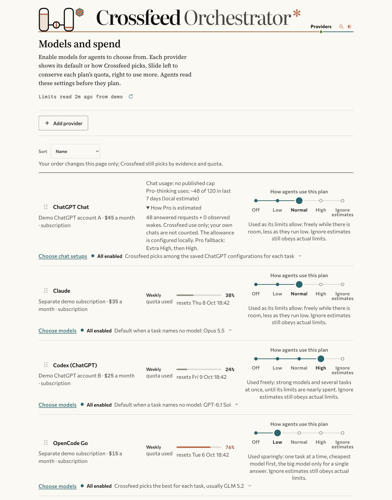
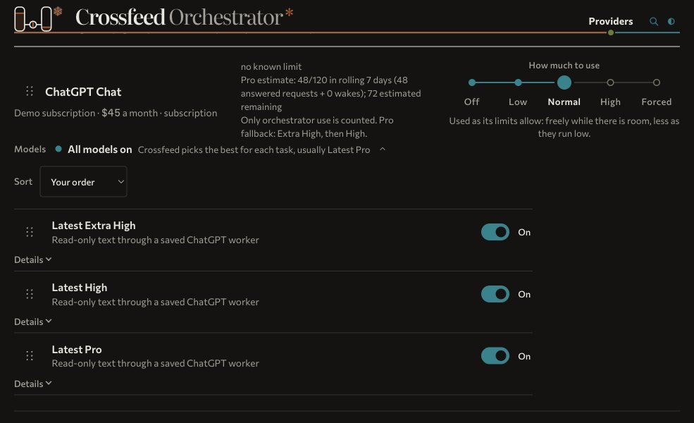

# Portable setup and evidence

Crossfeed Orchestrator routes AI work across your subscriptions and supervises each worker. An optional prompt-only metered transport ships disabled, with no spending authorization.

If you pay for several AI plans, your agents can use the others when one runs low. A local console sets which models they may use and how freely to spend each plan. Routing reads those settings before every job.

<picture>
  <source media="(prefers-color-scheme: dark)" srcset="console-dark.png">
  
</picture>

The screenshots use fictional plans, prices and usage. [Run the demo](DEMO.md) to see the same console without connecting an account.

## Install

You need Python 3.9+, bash, [jq](https://jqlang.org) and the vendor CLIs you want to use, each installed and signed in. Crossfeed uses the Python standard library.

```bash
git clone https://github.com/ABCastor/crossfeed-orchestrator ~/crossfeed-orchestrator
cd ~/crossfeed-orchestrator
mkdir -p ~/.config/orchestrator
cp examples/access-overlay.example.json ~/.config/orchestrator/access-overlay.json
python3 scripts/fleetctl.py doctor
python3 scripts/fleetctl.py console
```

The *overlay* is your machine's roster of plans, models and roles. The example has illustrative settings: replace them with your own, keep only signed-in, tested CLI lanes `verified`, and mark the rest `unverified`. `doctor` reports missing tools and setup gaps. In the console, **Add provider** connects a supported CLI or API endpoint without hand-editing the roster. API and CLI lanes still need verification before dispatch.

Agents can read [the skill](../skill/SKILL.md) from the checkout; [skill installation](SKILL-INSTALL.md) covers Claude Code, Codex, OpenCode and Pi. Linux setup is in [docs/LINUX.md](LINUX.md).

Crossfeed runs on its own with [Claude Code](https://docs.anthropic.com/en/docs/claude-code), [Codex](https://github.com/openai/codex), [Antigravity](https://antigravity.google), [OpenCode](https://opencode.ai), [Copilot CLI](https://github.com/github/copilot-cli) and [OpenRouter](https://openrouter.ai). [Pi](https://github.com/earendil-works/pi) supports admitted API and partner-plan routes.

Optionally, add Crossfeed Chat, currently private, to use your ChatGPT chats as a read-only agent lane. Its paired Chrome extension wakes sleeping workers; [setup and relay limits](CHATGPT.md).

Set `chatgpt_gateway.pi_coding` to `true` to add Pi coding routes with local tools for current High and Extra High workers. These share the ChatGPT account and model switches. Pi's `provider-default` evidence stays separate from plain Chat requests, and its receipts leave the underlying model unconfirmed.

`python3 scripts/fleetctl.py serve-api` exposes admitted read-only lanes to OpenAI-compatible clients; [API setup](LANES-API.md).

## Give it work

```bash
python3 scripts/fleetctl.py brief
python3 scripts/fleetctl.py select --role implementation --json
python3 scripts/fleetctl.py dispatch --role review --mode read-only \
  --prompt "Review the retry paths and report concrete defects." --dir "$PWD" \
  --last /tmp/review.txt
```

A *lane* is a model on a particular tool. Its funding is included access, verified-free, metered or unknown; an API key doesn't tell you which. Crossfeed selects a lane and thinking level, then runs its wrapper under a lease and watchdog. Each run records the selected model; provider identity is confirmed only when the provider supplies it. The brief and receipts separate incremental cash and reserved/settled dollars from pressure on a quota window.

The console has five spend levels: **off**, **low**, **normal**, **high** and **ignore estimates** (`forced` in the CLI). Model switches restrict which choices are available. Known exhaustion, provider refusals and configured paid caps remain hard gates, even when estimates are ignored. Missing quota measurements stay unknown. See [quota sources](QUOTA-REFRESH.md).



For parallel jobs, use `scripts/fanout.sh tasks.jsonl --parallel 3`. Give write-capable workers separate worktrees and verify their output before integrating it. [Selector details](SELECTOR.md) and [adapter contracts](ADAPTERS.md) cover configuration.

## Usage readings and the one key it can store

Crossfeed reads usage itself. No menu-bar helper, browser cookie or password manager is needed.

| What | Where it comes from | Needs |
| --- | --- | --- |
| Claude, Codex and Copilot windows | The provider's own usage endpoint, with the CLI's existing sign-in | The CLI signed in |
| Codex plan, renewal date, funded credits and credit use | Codex account billing endpoints, with the Codex CLI's sign-in | `billing` is on by default; set `billing: false` on the pool to turn it off |
| Antigravity model allowances, including Argon | The desktop app's local language server | `model_quota: ["argon"]` on the pool's `quota_refresh` |
| Antigravity cost by model | The desktop app's local history | `local_usage_cost: true` on the pool |
| Incident badge | Each provider's public status feed, cached five minutes | Nothing; hidden when all is clear |
| OpenRouter spend by model | OpenRouter's Activity endpoint | A management key (below) |

Every row is hidden when the provider gives nothing. A failed read keeps the last good value and says it is old.

### Storing the OpenRouter management key

Spend by model is the only reading that needs a key beyond the inference key, because OpenRouter returns Activity only to a management key with Activity read access. Create one at openrouter.ai/settings/management-keys, then store it in one of these ways. Crossfeed looks in this order and stops at the first hit:

1. The `OPENROUTER_MANAGEMENT_KEY` environment variable.
2. A 1Password reference, if `op` is installed: `fleetctl secret set openrouter-management --ref 'op://Vault/Item/field'`. Only the reference is stored.
3. The macOS Keychain.
4. The Linux Secret Service (`secret-tool`).
5. A mode-600 file under the orchestrator config directory, only when you pass `--plaintext` yourself.

```bash
fleetctl secret set openrouter-management      # reads the value from a hidden prompt or stdin
fleetctl secret status openrouter-management   # present or absent, and which backend; never the value
fleetctl secret delete openrouter-management   # removes it from every backend
```

The console has the same step: an "Add key" field on the OpenRouter card. It is a password field, the page clears it on submit and the value is never sent back to the page, logged or placed on a command line. Without a Keychain or Secret Service, `set` refuses and names the plaintext flag instead of writing a file quietly.

## Evidence and limits

**The selector has not yet been proven better than simpler routing policies on hard tasks.** On 5 October 2026, synthetic coding tests passed 12/12 for Sol High, 9/11 for ChatGPT High through Pi and 9/10 for ChatGPT Extra High through Pi. Only 23/36 ChatGPT cells were measured, none of its nine calibration cells ran, and its underlying model identity is unconfirmed. Sol High remains the default; admitted Pi relay workers can provide fallback capacity under quota pressure. The [benchmark harness](../bench/README.md) lets you measure your own tasks.

Copilot defaults to a read-only Auto observer. To select named workers within one subscription, follow the [account setup](../skill/references/lane-copilot.md). Antigravity read-only lanes need an admitted disposable snapshot path. Plain ChatGPT lanes are read-only; the optional Pi coding routes use local tools. Both draw from ChatGPT account quota, separate from Codex quota.

Quota exhaustion never authorizes paid dispatch. A bounded public-text paid route needs an operator-set cash envelope and durable reservation before it sends. Automatic selection is a separate operator grant; no retry may enter or leave a bounded paid attempt. See [cash setup and receipts](SELECTOR.md#cash-funding-and-owner-envelopes). The explicit Gemini text route keeps its estimate-only daily cap, outside the hard ledger. It can overshoot in flight and does not enable automatic paid routing. A charge on OpenRouter's free route stops dispatch and freezes that route until the operator reconciles it. A provider-side cap is a second backstop, not a substitute for the ledger.

```bash
bash tests/run-all.sh
```

The suite uses synthetic data and fake transports. It does not prove a live provider is available or that an agent's answer is correct.

## Licence

The code is [Apache 2.0](../LICENSE). The signature artwork and bundled fonts have separate terms in [NOTICE](../NOTICE).
